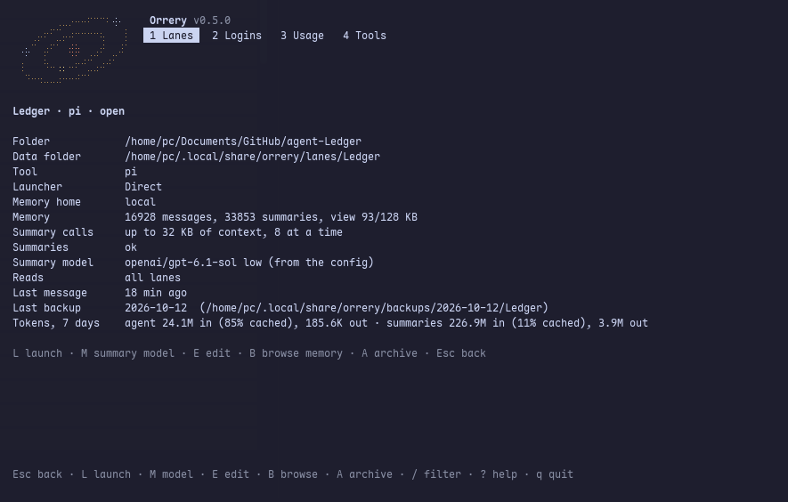

<p align="center"></p>

<h1 align="center">Orrery</h1>

<p align="center"><b>Persistent memory for coding agents, across sessions, models, tools and machines.</b></p>

<p align="center">
  <a href="https://github.com/Tech0001/orrery/actions/workflows/ci.yml"></a>
  
  <a href="LICENSE"></a>
</p>

<p align="center"></p>

Long-running projects outgrow a single agent conversation. Orrery gives each workspace, called a **lane**, one
append-only history and a tree of summaries over it. The agent works from a bounded, cache-friendly view of the
whole history and can zoom back into the original messages whenever it needs them. The memory belongs to the lane,
not the session, so you can start a new session, change models, move between pi, OMP and Claude Code, or continue
on another machine without starting over.

## Highlights

- **One memory, several tools.** Extensions for pi and OMP, a Claude Code plugin, and launches through
  OpenRouter's Ori all read and record the same lane.
- **Bounded, cache-friendly context.** A 64–128 KB view with more detail near the present. New lines extend a
  stable prefix, so providers can reuse the prompt cache. `zoom`, `date` and `search` tools retrieve the originals.
- **Compaction without a model call.** In Claude Code, the optional mod answers compaction from the lane's view:
  about two seconds and no tokens, with 99% of the prompt served from cache on a real session.
- **Separate agent and summary models.** Summaries use their own ChatGPT or OpenRouter sign-in, an OpenAI,
  Anthropic or OpenRouter API key, or a local model server. A new summary model is tested before a lane switches.
- **Memory that follows you.** Push a lane to your own SSH server or a Cloudflare Worker. Copies are encrypted
  before upload, one machine writes at a time, and another machine can take over.
- **One place for every lane.** A terminal UI for lanes, logins, usage and tools; the main views are also
  available as JSON for scripts.
- **Guarded credentials.** Agent tool calls that would read credential files are refused. This is a guard, not a
  sandbox; see [Safety](#safety).

## Screens

| Lane details | Logins and remotes |
| --- | --- |
|  |  |
| **Usage** | **Tools** |
|  |  |

## Quick start

You need Node **22.19 or newer**, npm, Git and a terminal. Install at least one supported coding tool separately;
Orrery wires its extension or plugin into that tool. You also need a summary source: a supported sign-in, an API
key or a compatible local model server.

### Install

```bash
git clone https://github.com/Tech0001/orrery.git orrery
cd orrery
npm_config_ignore_scripts=true npm ci
```

### Try the demo

Explore the TUI with fictional lanes before setting anything up:

```bash
npm run demo
```

The demo has five fictional lanes across pi, Claude Code, OMP and Codex, with canned memory, summaries and
illustrative usage costs. Browse with **1–4**, open a lane with **Enter**, and quit with **q**. It makes no model
calls, needs no tools or sign-ins, and removes its temporary home on exit. Your config and data stay untouched;
editing, sign-in, installation and launching are disabled in the demo. Codex remains launch-only, with no memory.

### Set up your lanes

Put the `orrery` command on your PATH:

```bash
mkdir -p ~/.local/bin
ln -s "$PWD/src/cli/main.ts" ~/.local/bin/orrery
export PATH="$HOME/.local/bin:$PATH"
orrery
```

Keep the checkout in place: the command and extensions load code from it. Add `~/.local/bin` to your shell's PATH
permanently if it is not already there. If an `orrery` command already exists, use that installation or choose a
new link location rather than replacing it blindly.

First-run setup asks where memory should live, which folder is your first lane, which tool to launch, and how to
make summaries. The usual config is `~/.config/orrery/config.toml`; `ORRERY_CONFIG` or `--config` can select another.

1. Open **Tools** (4), select pi, OMP or Claude Code, and press **I** to install Orrery's wiring.
2. Return to **Lanes** (1), select your lane, and press **L** to launch it. Quit the tool to return to Orrery.
3. Use **M** to change summaries, **E** to edit a lane, **N** to add one, or **B** to browse its memory.

**Logins** (2) manages summary credentials; **Usage** (3) shows recorded tokens and cache use. Press **?** for help.
Claude Code also needs the per-lane setup described in its guide. A lane can have only one recording session.

## How it works

New messages are appended to a local SQLite log. Background summaries build a binary tree over that log; the agent
receives a bounded view with more detail near the present. Between merge batches, new lines extend a stable prefix
so providers can reuse prompt caches. `zoom`, `date` and `search` retrieve the underlying history when needed.

The agent model and summary model are separate choices. Orrery keeps the same store when you change either one.
Read the [architecture guide](docs/architecture.md) for storage, the 64–128 KB view, summary scheduling and trade-offs.

Useful commands mirror the TUI:

```bash
orrery status
orrery status --json
orrery login openrouter           # Orrery's own sign-in for summaries
orrery login openrouter --manual  # paste a redirect URL or code over SSH
orrery launch Atlas
orrery backup
orrery help
```

## Coding tools

| Tool | Integration |
|---|---|
| [pi](docs/pi.md) | Extension with lane memory, recording, memory tools and `/compactor` |
| [OMP / oh-my-pi](docs/omp.md) | Host-specific extension entry; `/orrery`, `/compactor` and `memory_search` |
| [Claude Code](docs/claude-code.md) | Plugin with hooks and MCP tools; optional mod adds a memory system-prompt section and compaction control |
| [Ori](docs/ori.md) | Optional launcher using OpenRouter models; Orrery retains the lane's memory and its own summary login |
| Codex | Launch support only; no Orrery memory adapter yet, including through Ori |

Each guide lists the tested versions and known limits. Nightly backups, systemd units and the older `orrery run`
runtime are covered in [deployment and backups](docs/deploy.md).

## Memory that follows you

Keep a closed lane's memory on your own SSH server or Cloudflare Worker with
`orrery lane push Atlas --to home`, then set it up on another machine with
`orrery lane pull Atlas --from home --folder /path/to/project`. Remote copies
are encrypted with a recovery code you keep. See [remote lane setup and commands](docs/remote.md).

## Safety

Orrery's credential guard checks known sensitive paths and supported tool arguments. **It is not a sandbox**:
shell code, unknown plugin tools and host hook failures can exceed its coverage. See each tool guide for limits.

Credentials are stored outside the repository in private files with mode 0600. Enter keys through Logins or the
hidden terminal prompt, never in chat or committed config. Keep real conversations, exports, backup settings and
secrets outside the checkout. Local working copies are not encrypted; remote copies are encrypted before upload.
Model providers receive the context sent to them.

## Development

```bash
npm run check                    # TypeScript + the full test suite
npm run test:bun                 # alternate SQLite store check; requires Bun
```

The suite has more than 1,500 tests and uses synthetic fixtures and scratch data. Install `uv` to run the Python parity oracle as part of the suite;
without it those parity cases skip. The reference implementation lives in [reference/optchat-py](reference/optchat-py).

Real-tool tests run when their binaries are available and skip when absent. Override discovery to test a specific
installed binary, preferably the executable itself rather than an auto-updating shell wrapper:

```bash
ORRERY_TEST_PI=/path/to/pi npm test -- test/pi/real-pi.test.ts
ORRERY_TEST_OMP=/path/to/omp npm test -- test/omp/real-omp.test.ts
ORRERY_TEST_ORI=/path/to/ori ORRERY_TEST_PI=/path/to/pi ORRERY_TEST_OMP=/path/to/omp \
  npm test -- test/ori/real-ori.test.ts
```

These tests isolate agent homes and use fake model services. `ORRERY_TEST_ORI_STRICT=1` turns the named upstream
Ori/OMP compatibility skip into a failure. [Claude Code testing](docs/claude-code.md#testing) describes the separate
opt-in live script, which makes paid calls. CI checks Node 22 and 24 without requiring agent binaries or credentials.

[CONTRIBUTING.md](CONTRIBUTING.md) covers bug reports and pull requests. Report security problems privately as
[SECURITY.md](SECURITY.md) describes.

## Credits

The memory design follows [OptChat by Victor Taelin](https://gist.github.com/VictorTaelin/91837951a5ce5b38f341ec1ba1df6449).
Orrery builds on [pi](https://github.com/earendil-works/pi) and integrates with
[oh-my-pi](https://github.com/can1357/oh-my-pi). The Python reference remains useful for behavioral parity tests.

## License

MIT. See [LICENSE](LICENSE).
