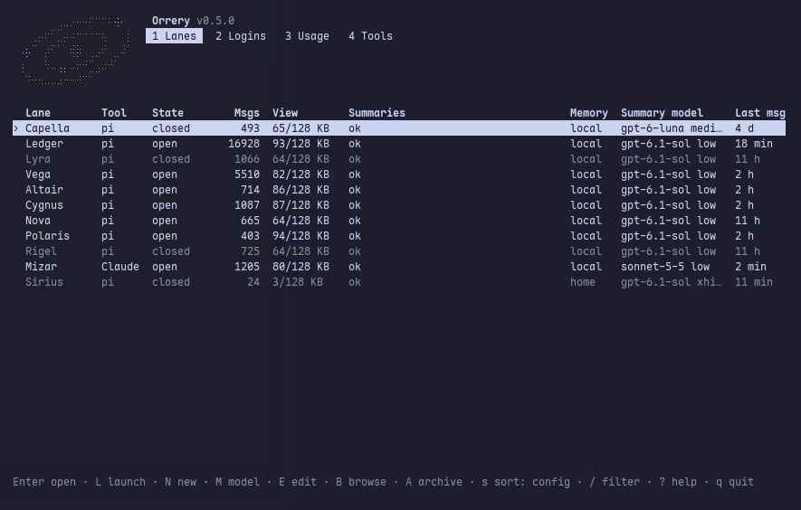
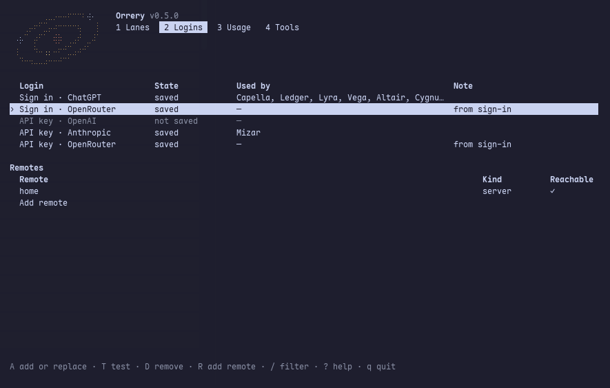
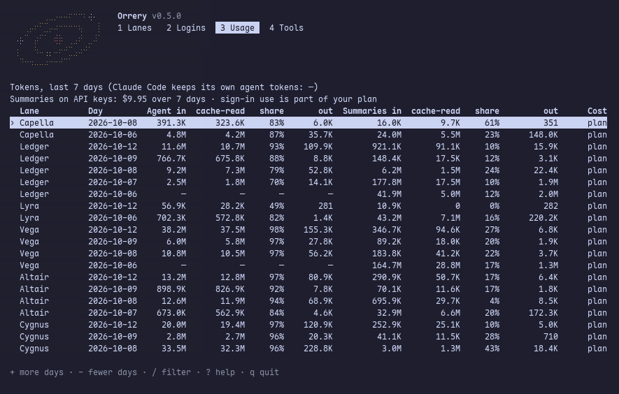
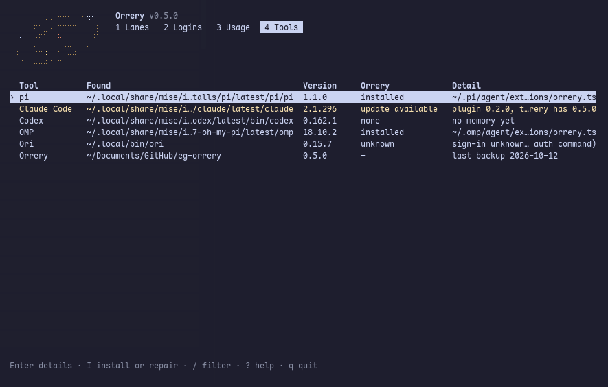

<p align="center"></p>

<h1 align="center">Orrery</h1>

<p align="center"><b>Persistent memory for coding agents, across sessions, models, tools and machines.</b></p>

<p align="center">
  <a href="https://github.com/Tech0001/orrery/actions/workflows/ci.yml"></a>
  <a href="LICENSE"></a>
</p>

<p align="center"></p>

A coding agent forgets everything when its session ends, and a long project outgrows any one conversation. Orrery
gives each of your agents a lasting memory: every message it has seen, plus a tree of summaries over them. The agent
works from a compact view of its whole history and can look up the original messages whenever it needs them.

The memory belongs to the agent, not to a session, a folder or a tool. Start a fresh session, change models, move
from pi to Claude Code, open the agent in another project or carry on from another computer, and it still remembers.

## What you can do

- **Keep one agent across tools.** pi, OMP (oh-my-pi), Claude Code, Codex and OpenCode all read and record the same
  agent's memory. OpenRouter's Ori can launch it too.
- **Open any agent anywhere.** `orrery agent Atlas` starts Atlas's tool in the folder you are in, with its
  instructions and memory. The folder's own `AGENTS.md` or `CLAUDE.md` still applies as that project's rules.
- **Turn existing chats into an agent.** Pick one or more of your Claude Code or Codex chats from a list and they
  become an agent that remembers those conversations. The chats themselves are only read, never changed.
- **Give each agent its instructions.** Who it is and how it works, sent to the model ahead of its memory.
- **Choose how summaries are paid for.** Sign in with your ChatGPT account (the one Codex uses) or OpenRouter, use an
  OpenAI, Anthropic or OpenRouter API key, or run a local model server. In OpenCode, a paid or own-key model of
  OpenCode's can make them too. See [Summaries](#summaries).
- **Let agents read each other.** An agent you allow can look up other agents' memory, read-only.
- **Compact Claude Code and OpenCode sessions for free.** OpenCode's compaction, and Claude Code's with the optional
  mod, is answered from the agent's memory: no model call, no additional tokens.
- **Take an agent to another computer.** Keep its memory on your own SSH server or a Cloudflare Worker, encrypted
  before it leaves your machine.
- **Back up and restore.** `orrery backup` snapshots every agent (on Linux, a systemd timer can run it nightly), and
  `orrery restore` puts one back.
- **See what it costs.** Tokens per agent and day, with cache hits and cost.
- **Install once, update in place.** One program, with no Node, npm or Git needed; `orrery update` and rollback.

## Screens

| Agent details | Logins and remotes |
| --- | --- |
|  |  |
| **Usage** | **Tools** |
|  |  |

## Quick start

You need:
- Linux or macOS, x64 or arm64. On Windows, use WSL. Alpine and other musl Linux is not supported yet.
- At least one coding tool: pi, OMP, Claude Code, Codex or OpenCode, installed on its own.
- A way to make summaries: a ChatGPT or OpenRouter account, an API key, or a local model server (see
  [Summaries](#summaries)).

**1. Install.**

```bash
curl -fsSL https://github.com/Tech0001/orrery/releases/latest/download/install.sh | sh
```

The script checks the download, installs Orrery into `~/.orrery`, and asks before connecting it to each coding tool
it finds (Codex and OpenCode need nothing: Orrery's side comes with each launch). It puts the `orrery` command in
`~/.local/bin`; add that folder to your PATH if it is not there already.

**2. Start Orrery.**

```bash
orrery
```

The first run asks where to keep memory, your first agent's name, its folder and tool, and how to make summaries: a
sign-in or an API key. For a local model server instead, add it to `~/.orrery/config.toml` first, as
[Summaries](#summaries) shows, and add the agent with **N**.

**3. Open your agent.** On the **Agents** page, select it and press **Enter**. If you started Orrery outside the
agent's folder, it asks whether to open the agent here or there. Its tool starts; quit the tool to come back.

**4. Add more.** Press **N** for a new agent. Start it empty, turn an existing Claude Code or Codex chat into it, or
(once you have a remote) fetch one from another computer.

### Getting around the TUI

| Page | Keys |
| --- | --- |
| **1 Agents** | **Enter** open · **i** details · **N** new · **M** summary model · **E** instructions · **C** settings · **s** sort · **/** filter. On an agent's details: **B** browse its memory, **A** archive it |
| **2 Logins** | **A** add or replace a sign-in or key · **T** test · **D** remove · **R** add a remote |
| **3 Usage** | **+** / **-** more or fewer days |
| **4 Tools** | **Enter** details · **I** install or repair Orrery's side of pi, OMP or Claude Code |

**?** shows help on any page and **q** quits. Nearly everything the TUI does can also be done from the command line;
`orrery help` lists the commands, and `orrery help <command>` every option of one.

## Agents

An agent is a name, instructions, memory and settings, all kept in `~/.orrery`:

    ~/.orrery/
      config.toml               settings: one [agents.<Name>] section per agent
      agents/<Name>/
        instructions.md         who the agent is
        memory.sqlite           what it remembers

**Instructions.** Edit them with **E** in the TUI or `orrery agent edit Atlas`. They reach the model ahead of the
memory, up to 32 KB. Only you edit them: an agent can suggest a change in chat but cannot make it.

**Default folder.** An agent can have one (`folder = "…"`, or **C** in the TUI). Starting its tool there, or in any
folder inside it, picks that agent automatically, as if you had run `orrery agent`. Choose a folder that belongs to
the agent, not a broad one like your home folder, or every session under it records into that agent. With no default
folder, the agent opens only through Orrery. Claude Code needs one setup step per agent first; Codex and OpenCode never
pick an agent by its folder, and open agents only through Orrery; see [Coding tools](#coding-tools).

**Importing chats.** **N**, then **From an existing chat**, lists your Claude Code and Codex chats, newest first,
and marks the ones written to in the last ten minutes as in use. Pick one, or mark several with Space and they are
combined in time order. Orrery reads them, shows a short report, and creates the agent. Its memory builds in the
background, the agents list shows the progress, and the agent opens once the build is done. An import is a
snapshot: anything said in those chats later is not in the agent. From the command line, `orrery import` can also
gather a whole project's Claude Code and Codex history; see `orrery help import`.

**Reading other agents.** In the agent's `[agents.<Name>]` section of `config.toml`, `reads = ["Atlas", "Birch"]`
(or `["*"]` for all) lets it use the `agents` and `agent_memory` tools to look into those agents' memory, read-only.

**One session at a time.** An agent records from one session. A second session on the same agent runs without its
memory in pi and OMP, and read-only in Claude Code, Codex and OpenCode.

**Archiving.** **A** on a closed agent's page takes it out of the list; its memory stays on disk.

## Summaries

Each agent has two models: the one you chat with, chosen in your coding tool, and the one that writes its summaries,
chosen in Orrery. They are independent: change either one and the memory stays the same.

| Summaries from | Set up with | Notes |
| --- | --- | --- |
| Your ChatGPT account (the sign-in Codex uses) | `orrery login openai` | Opens your browser; `--manual` to paste the result over SSH |
| OpenRouter | `orrery login openrouter` | Signs in and saves an OpenRouter key |
| An API key: OpenAI, Anthropic or OpenRouter | `orrery login --key anthropic` | Typed into a hidden prompt; `--from-pi` copies a key pi already has |
| A local model server | `[[providers]]` in `config.toml` | Any OpenAI-compatible server, such as llama.cpp |
| A paid or own-key model of OpenCode's | `/compactor` in OpenCode | Only while the agent is open in OpenCode; OpenCode's free models are not offered ([why](docs/opencode.md#summaries-through-opencode)) |

The **Logins** page does the same. Orrery keeps its own logins, separate from your coding tools', in a private file
(mode 0600).

To choose an agent's summary model, press **M** on the Agents page, or use `orrery compactor Atlas` to see its
current one, `orrery compactor Atlas signin` (or `key`, `local`) to list choices, and, for example,
`orrery compactor Atlas key anthropic/<model>` to switch. The new model is tested with a real call first; if that
fails, the agent keeps the old one.

A local server looks like this in `config.toml`:

```toml
[[providers]]
id = "llama"
base_url = "http://127.0.0.1:8080/v1"
models = [{ id = "my-model", context_window = 32768, max_tokens = 8192 }]
```

`orrery compactor Atlas local llama/my-model` then switches to it. If the server needs a key, `api_key_env = "NAME"` sends
the one in that environment variable.

## Coding tools

| Tool | What Orrery adds | Guide |
| --- | --- | --- |
| pi | An extension: memory, recording, the memory tools and `/compactor` | [docs/pi.md](docs/pi.md) |
| OMP (oh-my-pi) | The same, through OMP's own extension entry; `/orrery` and `/compactor` | [docs/omp.md](docs/omp.md) |
| Claude Code | A plugin with hooks and memory tools, plus an optional mod for the system prompt and compaction | [docs/claude-code.md](docs/claude-code.md) |
| Ori | Launches the agent with an OpenRouter model; Orrery keeps the memory | [docs/ori.md](docs/ori.md) |
| Codex | Memory, recording, the memory tools and the guard, on Codex's command line at each `orrery agent` launch | [docs/codex.md](docs/codex.md) |
| OpenCode | A plugin for each `orrery agent` launch: memory, recording, the memory tools, the guard, compaction from memory and `/compactor` | [docs/opencode.md](docs/opencode.md) |

Connect a tool with **I** on the **Tools** page, or `orrery tools install pi`. Each guide lists the versions tested
and the known limits. Claude Code needs one more step per agent before it records, described in its guide:
`orrery claude-setup Atlas` loads the memory in the agent's default folder, and `--mod` loads it through the mod,
which also lets Claude Code open the agent in any folder. Codex needs nothing installed: open its agents with
`orrery agent Atlas --tool codex` (or set the agent's tool to `codex`), which brings Orrery's hooks, memory tools and
instructions on Codex's command line and writes nothing to `~/.codex`. A plain `codex` is not an agent's session.
Neither does OpenCode: `orrery agent Atlas --tool opencode` (or the agent's tool set to `opencode`) starts
`opencode --standalone` with Orrery's plugin for that launch, after checking once per OpenCode version that the plugin
loads, and writes nothing to OpenCode's config. A plain `opencode` is not an agent's session either.

The Claude Code desktop app works too: after `orrery claude-setup <Name>`, start a session in the agent's folder, and
the app's Claude Code records it and loads the memory (tested with the Linux app). Claude Code on the web runs in the
cloud and can't reach the memory on your machine.

## If you are an agent helping someone with Orrery

The TUI is for people; you have the command line. `orrery help all` lists every command and option. Start here:

| To | Run |
| --- | --- |
| See every agent, whether it is open, and its memory and summary state | `orrery status --json` |
| See which coding tools are installed and connected | `orrery tools --json` |
| See which sign-ins and keys are saved (never the keys themselves) | `orrery logins --json` |
| See token use and cost | `orrery usage --json` |
| Add an agent, or change its folder, tool or settings | `orrery agent add …`, `orrery agent set …` |
| See or switch an agent's summary model | `orrery compactor <Name> …` |
| Preview importing chats into an agent | `orrery import <Name> --dry-run …` |

Leave these to the person, in their own terminal:

- **Sign-ins and API keys.** `orrery login` opens a browser, and `orrery login --key` asks for the key in a hidden
  prompt. Never ask for a key in chat.
- **Instructions.** `orrery agent edit` needs a terminal, and an agent's instructions are its person's to change.
- **Installing, updating and uninstalling.** These ask questions on the terminal and replace the program you are
  running on.
- **Committing an import.** Show the person the dry-run report, and run `orrery import <Name> --commit <preview file>`
  only once they have read it.

Orrery's own files are off-limits to agents: your tools are refused anywhere in `~/.orrery`, except that file tools may
read the config and the installed program, and shell commands that name `.orrery` are refused. Ask the CLI instead.
Shell commands that name Orrery's hook plumbing (`codex-hook`, `claude-hook`, or `orrery` with `holder`) are refused
too, even in a `grep` or a commit message: leave those to the person. So are shell commands that name OpenCode's
config (`opencode.json`, a `.opencode` folder, OpenCode's own folders) or a skills folder (`.claude/skills`,
`.agents/skills`): read those with your file tools. You can't write OpenCode's config, so ask the person to set up
OpenCode for a project; skills you may write with your file tools, with plain YAML front matter. Your own memory has
its own tools: `zoom`, `date` and `search` (`memory_search` in OMP; in Codex, from the `orrery` MCP server).

## Memory that follows you

Push a closed agent to a remote, then pull it on another computer:

```bash
orrery agent push Atlas --to home      # on the first computer
orrery agent pull Atlas --from home    # on the second
```

A remote is a folder on your own SSH server or a Cloudflare Worker (`orrery remote add`). Memory and instructions are
encrypted before upload with a recovery code that only you keep. One computer writes at a time, and another can take
over. See [remote agents](docs/remote.md).

## Backups

`orrery backup` snapshots every agent's memory and instructions into `~/.orrery/backups/` and keeps 14 days.
To put one back, close the agent first, then run `orrery restore Atlas --from 2026-10-01`. It keeps the agent's current
instructions if it has any. On Linux, a systemd timer can run
the backup every night and copy it to another machine over SSH; on macOS, run it yourself for now. See
[deployment and backups](docs/deploy.md).

## Updating and uninstalling

```bash
orrery update              # install the latest release
orrery install --rollback  # go back to the previous version
orrery uninstall           # remove the program; memory, config and logins stay
```

Agents that are open keep their version until they restart. The Agents page says when one is waiting, and the pi, OMP,
Claude Code, Codex or OpenCode session says once: "Orrery was updated to 0.6.2; restart this session to use it." Orrery
checks for a new release at most once a day, shared by the TUI and every agent's session (pi, OMP, OpenCode, and the
recorder of Claude Code and Codex sessions); the TUI header and each session then say once that it is out. A session
never waits on the check: it shows what the last one found, and a newer answer when it comes. The check is one request to `github.com`,
which sees your IP address; `check = false` under `[updates]` in `config.toml` turns it off, and the release notice with
it (the restart notice needs no request and stays). Notices reach you, never the model. `orrery uninstall --purge` also
deletes `~/.orrery`, after you type `delete`.

The install script also takes `--yes` (answer every question yes; with no terminal and no `--yes`, it skips the
questions, lists them and exits non-zero), `ORRERY_VERSION` (a specific release) and `ORRERY_HOME` (somewhere other
than `~/.orrery`; set it in your shell profile too, since every `orrery` run and coding tool reads it):
`curl -fsSL … | ORRERY_VERSION=0.6.0 sh -s -- --yes`.

## How it works

Each message is appended to the agent's own SQLite file. In the background, a summary model builds a binary tree of
summaries over those messages. The agent receives a 64–128 KB view: recent messages word for word, older ones as
summaries that get coarser with age. Between rebuilds, new lines only extend the view, so providers can serve most
of the prompt from cache. The [architecture guide](docs/architecture.md) covers the store, the view, scheduling and
the trade-offs.

## Safety

Orrery guards credentials: an agent's tool calls that would read key files, your logins or another agent's memory are
refused, and Orrery's own config and program are read-only to agents. Out of the box, agents can neither read nor edit:

- **Keys and logins in your home folder:** `~/.ssh`, `~/.gnupg`, `~/.aws/credentials`, `~/.kube/config`,
  `~/.docker/config.json`, `~/.config/gh/hosts.yml`, `~/.netrc`, `~/.git-credentials`, `~/.pgpass`, `~/.npmrc`,
  `~/.pypirc`, `~/.cargo/credentials`, `~/.gem/credentials`, `~/.config/gcloud`, `~/.azure`,
  `~/.terraform.d/credentials.tfrc.json`, wrangler's login (`~/.wrangler`, `~/.config/.wrangler`, and
  `~/Library/Preferences/.wrangler` on macOS), Hugging Face's tokens, `~/.password-store`, the 1Password CLI's
  `~/.config/op`, and the logins of pi, OMP, Codex, OpenCode (its database, wherever `XDG_DATA_HOME` or
  `OPENCODE_DB` puts it) and Orrery (Claude Code's too, in its sessions).
- **Secret files in any folder:** `.env` and `.env.<anything>`, `.dev.vars` and `.dev.vars.<anything>` (Cloudflare
  Workers), `.secrets`, `secrets.toml`, `master.key` and `.htpasswd`. The shared templates stay open: `.env.example`,
  `.env.sample`, `.env.template` and `.env.dist`, and the same for `.dev.vars`.

You edit those files yourself. A project's own `.npmrc`, `.pypirc`, `.azure` or `.wrangler` is not a login and stays
open, and so do `npm`, `cargo`, `gcloud`, `az`, `wrangler`, `pass` and `op` themselves: only naming the protected files
and folders is refused. An agent's file edits also stay inside the folder it was opened in; `allowed_roots =
["/abs/path"]` in its `[agents.<Name>]` section adds more.

**You can add your own files and folders.** List them under `[guard]` in `~/.orrery/config.toml` (or the file
`ORRERY_CONFIG` names), and every agent is kept from them, in every tool:

```toml
[guard]
protect = [
  "~/finance",           # a folder in your home, and everything in it
  "/srv/keys/prod.pem",  # one file, by its full path
  "secrets.yml",         # every file or folder with this name, in any folder
  ".envrc",
]
```

New configs already have this block, with its examples commented out: uncomment a line or add your own. An older
config gets it once, the first time `orrery setup` runs (it runs on install and on `orrery update`); if you delete it,
it does not come back.

An entry that starts with `/` or `~/` is a path: that file, or that folder and everything in it. An entry with no `/`
is a name: every file or folder with exactly that name, in any folder. Letter case is ignored, and so is how an accent
is encoded (macOS file systems ignore both). Globs (`*.pem`), relative paths (`keys/prod.pem`), backslashes, drive
letters and names starting with `~` are not supported: such an entry is a config error, and so is a `protect` key
anywhere but under `[guard]`. The table must be spelled `[guard]`: a misspelt one (`[gaurd]`) is not noticed and
protects nothing. Agents cannot change the list, since the config is read-only to them. A refusal says which entry it
came from.

**A search of a folder can still read a `.env` inside it.** The same goes for the other secret files named above and
a file a name entry protects: the guard refuses tools that name the file, but a grep of the folder that holds it reads
it too. A path entry and the logins in your home folder do not have this gap: a search of a folder that holds one is
refused.

If `config.toml` cannot be read, pi and OMP sessions keep the built-in rules, and its `[guard] protect` when that part
of the file reads cleanly; if it does not (the TOML is broken around it, or an entry is refused), they refuse every
tool call until the config is fixed, as Claude Code does for any config it cannot read. A `[guard] protect` that lists
nothing, as a new config has it, counts as no entries even when the TOML is broken elsewhere.

**Agents can't run Orrery's hook plumbing.** Shell text that names the hook commands (`codex-hook`, `claude-hook`) or
Orrery's program with `holder` is refused, so an agent cannot feed a hook made-up input and put words in your mouth in
its memory. The cost: an agent's `grep` for those names, or a commit message that mentions one, is refused too.

**Agents can't change OpenCode's config or code, in any tool.** OpenCode loads plugins, runs commands and takes
permissions from its config, with no prompt, the next time it opens a folder, so a file an agent wrote there from any
tool would run inside OpenCode. No agent may write `opencode.json` or `opencode.jsonc` in any folder, a `.opencode`
folder, OpenCode's own config, cache and state folders (`~/.config/opencode`, `~/.cache/opencode`,
`~/.local/state/opencode`, or where `XDG_*` and `OPENCODE_CONFIG_DIR` put them), its database, the file
`OPENCODE_CONFIG` names, or its system config (`/etc/opencode`). File tools may read them; shell text that names one
is refused, a `cat` or a `grep` too. The cost: an agent can't set up OpenCode for a project (you write those files
yourself), and an agent's shell command that only names one, such as a commit message, is refused.

**Skills stay ordinary files.** OpenCode also loads the skills in `.claude/skills` and `.agents/skills`, and runs a
skill's front matter as code when it opens with `---js`. Agents may write skills with their file tools, judged by what
the file will hold: a skill that would open with `---` and anything other than YAML or JSON is refused, and so is a
write whose result the guard can't see (a copy or a move into a skills folder, a notebook cell, an MCP tool that may
write, OMP's edit; each tool's guide says which). Shell text that names a skills folder is refused, whatever the
command. The cost: an agent's `ls`, `cat`, `git add` or commit message that names a skills folder is refused, and in
Codex, which reads files through its shell, an agent can't read a skill or OpenCode's config at all. `AGENTS.md` and
`.claude/settings.json` stay writable.

**It is a guard, not a sandbox.** It checks file paths and the text of shell commands, so a determined program can get
around it; the [architecture guide](docs/architecture.md#the-credential-guard) lists the known limits, and
[Codex's](docs/codex.md#its-limits-in-codex) and [OpenCode's](docs/opencode.md#its-limits-in-opencode) guides the ones
that are their own.

Logins are kept in private files (mode 0600), never in the config. Your agents' memory on disk is not encrypted;
copies sent to a remote are. Model providers see whatever context is sent to them, memory included.

## Development

From a checkout (see [CONTRIBUTING.md](CONTRIBUTING.md#setup)):

```bash
npm run check           # TypeScript and the full test suite
npm run test:binary     # the compiled program; needs Bun (see .bun-version)
npm run test:bun-suite  # the full suite on Bun
npm run demo            # the TUI with five fictional agents: no model calls, nothing of yours touched
```

The suite has more than 2,000 tests and uses synthetic data only. Tests against real pi, OMP, Ori, Codex and OpenCode
run when those programs are installed; CI runs the suite on Node 22.19 and 24 and on macOS.
[CONTRIBUTING.md](CONTRIBUTING.md) covers bug reports, pull requests and the real-tool tests; [SECURITY.md](SECURITY.md) says how to report a security problem
privately.

## Credits

The memory design follows [OptChat by Victor Taelin](https://gist.github.com/VictorTaelin/91837951a5ce5b38f341ec1ba1df6449).
Orrery builds on [pi](https://github.com/earendil-works/pi) and integrates with
[oh-my-pi](https://github.com/can1357/oh-my-pi). The Python reference in [reference/optchat-py](reference/optchat-py)
is used for behavioral parity tests.

## License

MIT. See [LICENSE](LICENSE).
