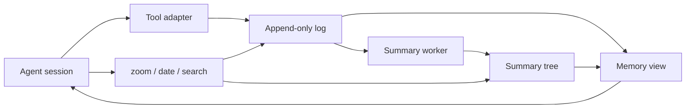

# Architecture

Orrery gives an agent a memory that survives changes of session, folder, coding tool and model.
An agent is a name, instructions, memory and settings, kept in Orrery's data folder; where it works is wherever it is opened.
The coding tool still owns the current interaction: its editor, terminal, tools and agent model.
Orrery records selected conversation events, builds summaries, and supplies a bounded view of the past.

This separation is useful when a project outlives one model's context window.
Starting a new session should not require retelling every decision.
Switching from pi to Claude Code should not create a second, unrelated project history.
Changing the agent model should not change where its memory lives.
The store is local and inspectable; summaries are derived data rather than the only surviving record.

## An agent from prompt to recall

An agent has a data directory under `data_dir/agents/<Name>/`, a summary model, and optionally a default folder.
The `tool` setting selects pi, OMP, Claude Code, Codex or OpenCode for launching.
The optional `launcher` setting selects direct launch or Ori.
Those launch choices do not select a different memory database: each tool reaches the same memory through its own
adapter.

The data directory holds everything that makes the agent:

```
<data_dir>/                 ~/.orrery by default; the config has one [agents.<Name>] section per agent
  agents/<Name>/
    instructions.md        who the agent is (up to 32 KB reach the model)
    memory.sqlite          what it remembers
    status.json, logs, ... everything else the agent needs
```

`instructions.md` is Markdown the person writes (the TUI's `E`, or `orrery agent edit <Name>`); it is never confused
with a project's own `AGENTS.md`. The adapter adds it to the system prompt under `# Agent: <Name>`, before the memory
section, and a longer file is cut at 32 KB with a notice.



At a session boundary, the adapter chooses the agent. It takes, in order, the agent `ORRERY_AGENT` names (set by
`orrery agent <Name>`; an unknown name gives a notice and no memory), then the agent whose default folder holds the
working directory, then none. `orrery agent` also sets `ORRERY_AGENT_TOKEN`, a one-time token whose claim the first
session process takes (a file named by the token in the agent's `claims/` folder). A tool the agent starts itself
inherits both variables but not the claim, and it runs inside the agent's session, so it opens no memory at all (see
[Agent sessions](#agent-sessions)). A session
belongs to the agent that first ran in it; another agent that resumes it records from its tail.
It opens the writer if available, loads the saved view, and starts summary work.
Before an agent run it adds memory according to the host's supported prompt mechanism.
Selected new messages enter the log with stable source identities or cursors where the host provides them.
A later session reads the same log and view, regardless of the previous agent's model.

The host adapter decides what constitutes a recordable event.
pi and OMP record user messages and completed assistant text, without copying every tool exchange.
Claude Code's plugin records prompts and final replies through hooks.
OpenCode's plugin records prompts and the final reply of each run, inside OpenCode's server process.
The older durable runtime and imported histories can contain additional message kinds.
Hidden reasoning is not a memory source.

## The store

Each agent's `memory.sqlite` contains four logical areas:

| Table | Contents |
|---|---|
| `main` | Ordered messages: kind, original text, byte size and date |
| `tree` | Summaries addressed by tree level and position |
| `meta` | Saved view, adapter progress and other small persistent state |
| `usage` | Agent or summary usage reported to Orrery |

The message log is append-only during normal operation.
Summaries do not overwrite the original message.
Messages and progress markers can be committed together, so a restart can distinguish new work from replay.
This matters when an adapter receives the same session history after resume or rewind.
It also makes a failed import transaction easier to reason about.

The database uses WAL mode and full synchronization for writes.
Text is stored as UTF-8 blobs because tool and imported text may contain embedded NUL characters.
Using blobs avoids truncation in the Node SQLite text interface.
Byte sizes are UTF-8 byte counts, not JavaScript string lengths and not model token counts.
Unicode and binary-shaped text are covered by the storage tests.

Node uses its built-in SQLite implementation.
An alternate backend uses Bun's SQLite interface behind the same small database abstraction.
The Bun store check exercises that backend independently.
A database snapshot and a JSONL export provide recovery paths outside the live process.
Neither the database nor the export is encrypted by Orrery.

## One writer, many readers

One process owns an agent's writer at a time.
Opening the writer also holds an exclusive SQLite lock on a separate `.lock` database.
The operating system releases this lock when the process dies.
There is no stale lock directory to remove and no decision based only on a reused process ID.
The lock database filename can remain on disk after a clean exit.

Status pages, memory tools, exports and other authorized agents use read-only snapshots.
Readers do not take the writer lock or advance the writer's progress.
A second pi or OMP session cannot quietly become a second recorder.
It reports the conflict and runs without agent memory, while applicable guard rules remain active.
Claude Code, Codex and OpenCode provide a read-only session while another session owns the agent.

The rule applies across tools, not just across two copies of the same executable.
Close the recording session before opening the agent in another tool.
Restoring or importing memory also requires the writer to be closed.
This keeps ordering and exactly-once recording tractable without a distributed coordination service.
It intentionally does not support concurrent collaborative writers.

## The summary tree

Every message can have a short leaf summary.
Two adjacent siblings can have a parent summary covering both ranges.
Repeated pairing creates a binary tree over the ordered log.
A parent is built only after its children are available.
Older ranges can therefore be represented at progressively coarser detail.

The default target for a summary node is 512 bytes.
The model receives a length ruler and can be asked to shorten an oversized answer.
The summarizer retains the shortest candidate after its bounded shortening attempts.
A summary is useful context, not a proof that every fact survived compression.
The original message remains available when a summary is incomplete or misleading.

Summary work runs in the background with configurable parallelism.
Ready merges take priority over ready leaves, so a long import does not postpone the whole upper tree.
Leaves are admitted near the frontier of built context.
Queues track work made ready by each append or completed node.
Scheduling does not repeatedly scan the entire history to find candidates.

Provider failures leave the source messages intact.
Failures are retried and surfaced through status and notices.
An unavailable or stopped summary source is visible in the TUI and tool footer.
If the adapter's wait budget expires, a run may see unsummarized placeholders it can inspect through memory tools.
The product does not silently present a stopped compactor as healthy.

## The view is a cut through the tree

The agent does not receive every message or every summary.
A `MemoryView` selects non-overlapping parts that cover the history in order.
Recent material has finer detail; older material can use larger summary ranges.
Each rendered line carries an address such as `id+n|text` inside a `<chat>` block.
The address links the compressed representation back to its source range.

`zoom(id, n)` expands a range into its two children.
With `n = 1`, it returns the original message in full.
Larger spans must be aligned powers of two with available children.
`date(id)` returns a message's timestamp.
`search` finds words or a regular expression in the original log, newest first.
OMP calls this last tool `memory_search` to avoid its own search-tool naming conflict.

An agent may be granted reads of named other agents, or `reads = ["*"]` for every agent, including ones added later.
The person sets this with the TUI's Reads checklist (`C`) or `orrery agent set <Name> --reads A,B|all|none`; new agents read nobody, and an agent always reads itself.
Such a reader also gets `agents` and `agent_memory`.
`agents` lists only the agent itself, the agents it may read, and remote agents' public facts.
These tools use snapshots; they never append to the other agent.
Their access checks use the configured agent relationships, read when the agent opens; pi and OMP register the reader tools once per process.
The memory browser exposes the current view, source messages and summary tree to the user.

## Keeping the prompt prefix stable

Prompt caching depends on repeated prefixes, so reshuffling old lines every turn is expensive.
Orrery lets the view grow between occasional batches of merges.
At the default settings, its built content grows from about 64 KB toward a 128 KB ceiling.
These are decimal byte budgets, not guaranteed token-window sizes.
A host prompt, tools and current conversation add their own tokens on top.

Appending a message adds a new line at the end; it does not immediately merge old lines.
When built content crosses the ceiling, a batch merges eligible sibling pairs toward the half-size floor.
Only a pair whose parent summary exists can be merged.
If summaries lag, the batch progresses as the required parents become available.
Unbuilt placeholders count as zero built bytes.

The merge priority measures a pair's age from its last message, scaled by its level.
Ties prefer older pairs.
This avoids repeatedly rewriting an old prefix merely because its first message is very old.
Between merge batches, the existing view lines remain unchanged and new lines extend their suffix.
Tests compare those prefixes byte for byte over long synthetic histories.

The selected parts are saved as `view.parts` metadata.
Reopening an agent loads that selection rather than recomputing a different cut through the same tree.
Readers use the same saved selection.
A missing or invalid saved view is rebuilt once; a read-only reader rebuilds only in memory.
New messages appended outside the view join as additional lines on the next open.

Persistence is designed to recover from an interrupted merge batch.
A crash can leave an older valid view, and the next writer continues from it.
The view is a performance and context selection, while the log is the underlying record.
This distinction allows recovery without replacing the original messages.
It also avoids rebuilding already completed summaries merely because the selection changes.

## Summaries need a smaller context

A summary call receives its own view, normally between 16 KB and 32 KB.
Its ceiling is configurable through `compactor_context_bytes`, with a floor at half that value.
At open it is derived from the chat view and merged further.
After that it grows and batches independently in memory.
It is not repeatedly rebuilt whenever the agent view merges.

The context ends at the node being summarized and includes only built lines.
A leaf's context stops before that message; a merge can see through the range it covers.
No placeholder or partial message is presented as a completed summary.
A fixed summary system prompt precedes the context and task.
Agent names and changing timestamps do not churn that fixed prefix.

For providers supporting explicit cache marks, context is grouped into blocks of four lines.
The Anthropic request path marks a stable whole block as well as the request end.
When several jobs share a new prefix, one starts before the others so it can establish the cache entry.
Other providers use their own prefix-caching rules.
A stable prefix makes reuse possible; it does not guarantee a particular provider's cache-hit rate.

The agent and compactor may use different models and different credentials.
Their caches should therefore be treated separately.
The smaller summary view limits input even when a provider does not reuse its cache.
Usage records expose input, output and reported cache tokens so the effect can be measured.
A summary attempt that failed once its request left is recorded too, with zero tokens; one that failed before any
request left (no login saved, a model no longer offered) is not.
The TUI distinguishes subscription-backed usage from priced API usage where that information is available.

## Adapters and boundaries

The memory core in `src/memory/` does not depend on an agent UI.
Shared agent code handles configuration, model sources, tools, notices and settings requests.
Each host adapter translates its own event and tool shapes into those shared operations.
The TUI and CLI use the same agent settings and launch plans.
A launcher does not become an additional memory writer.

**pi:** the extension adds the view to the system prompt and trims already-recorded history at run boundaries.
It preserves the current interaction while long-term history is represented by the agent's view.
Session identities and recording progress prevent ordinary resumes from copying the same messages twice.
The extension uses pi-supplied pi-ai entry points when loaded by the compiled executable.
Tests enforce this import boundary because a second, incompatible provider runtime can fail only at call time.

**OMP:** a separate entry point uses the compatible extension layer with host-specific tool and event handling.
Orrery temporarily disables overlapping OMP memory and compaction behavior for the agent's session.
Those settings are restored when the session leaves the agent.
This relies on some OMP internals and is version-sensitive; failure produces a visible status notice.
See [OMP](omp.md) for guard coverage, overflow behavior and tested versions.

**Claude Code plugin:** short-lived hooks spool prompts and final replies to an agent holder process.
The holder owns the writer, drains events and runs summaries.
A writing hook acts only when Claude Code itself called it, and the holder records a prompt only once Claude Code's transcript confirms it (see [Agent sessions](#prompts-checked-against-the-tools-record)).
An MCP server exposes memory tools through read-only access.
Trusted per-folder setup controls which folders receive the view file and recording behavior. The file setup works in an agent's default folder only; the mod brings the agent anywhere.
Shared repositories use local files and local Git exclusions rather than changing shared project instructions.

**Claude Code mod:** the optional mod supplies dedicated system-prompt sections for the agent's instructions and its memory.
The sections stay stable between session boundaries and compactions.
The mod can replace compaction while the existing hooks continue recording and guarding.
It depends on the host's mod interface and is more tightly coupled than the plugin alone.
See [Claude Code](claude-code.md) for setup, compaction behavior and current limitations.

**Codex:** nothing is installed into Codex.
`orrery agent` launches it with `-c` flags that supply the hooks, their trust values, the MCP server and the agent's instructions for that one process, and turn Codex's own memory feature off.
The hooks and the holder are Claude Code's, generalized to a host process: hooks spool prompts and final replies, and the holder owns the writer.
The holder records a prompt or reply only once Codex's rollout of the session confirms it (see [Agent sessions](#prompts-checked-against-the-tools-record)).
The session-start hook returns the memory section as developer context at the start and after each compaction; Codex keeps its own compaction, since its provider may compact remotely.
The agent is the one `ORRERY_AGENT` names, with its token; no folder picks it, so a plain `codex` is no agent's session.
Before a Codex or Orrery version it has not seen, the launch asks Codex's app server whether the hooks load, because Codex skips an untrusted hook silently.
See [Codex](codex.md) for the guard's Codex-specific limits.

**OpenCode:** nothing is installed into OpenCode either.
`orrery agent` launches `opencode --standalone`, a private server for that one launch, with `OPENCODE_CONFIG_CONTENT` naming Orrery's plugin folder, the agent and the path of a 0600 token file; the token never enters OpenCode's environment, which the model's shell and MCP servers inherit.
The plugin runs in OpenCode's server process for the session, as pi's extension does in pi: it holds the writer, records each run's prompt and final reply, runs summaries, and adds the instructions and memory section as the last system parts, the same bytes on every request of a session in that OpenCode until its compaction.
It answers OpenCode's compaction from memory with no model call, names sessions so no title request is sent, and gives `zoom`, `date` and `search` as plugin tools.
The guard runs on OpenCode's tool hook with its own deadline, since OpenCode sets none, and again at OpenCode's permission check for reads and edits.
Summaries can also go through a paid or own-key model of OpenCode's, as short-lived OpenCode sessions, while the agent is open there; OpenCode's free tier is not offered.
Before an OpenCode or Orrery version it has not seen, the launch asks a private OpenCode server whether the plugin loads.
See [OpenCode](opencode.md) for the details and the guard's OpenCode-specific limits.

**Ori:** Ori supplies OpenRouter models to the agent executable.
Orrery launches `ori pi`, `ori omp`, `ori claude` or `ori codex` in the folder the agent is opened in.
The optional `ori_model` is passed through as `--model`.
Ori's pi provider suppression affects the session registry; Orrery's separate summary registry survives it.
[Ori](ori.md) records the tested startup incompatibility with OMP and the manual Claude check still required.
OpenCode agents are not launched through Ori yet.

**Durable runtime:** `orrery run <Name>`, which starts an agent's own harness in the terminal it runs in, remains an alternative built on pi-durable.
It owns a durable session database alongside the memory store and can execute tools over SSH.
Its projector commits recording progress with memory appends.
This path also underlies the optional always-on deployment helpers.
It is retained alongside the extensions, with a broader dependency surface and separate tests.

## Summary sources and credentials

Summary sources are grouped as Sign in, API key and Local.
OpenAI sign-in and OpenRouter PKCE sign-in are offered independently of the coding tool's account.
API keys are entered through a hidden terminal field or the Logins page.
Custom compatible model servers come from explicit provider configuration.
A candidate model is tested before a settings change replaces the working summary source.
An agent open in OpenCode may also use a paid or own-key model of OpenCode's (`opencode/<provider>/<model>`), through OpenCode's providers and logins; elsewhere such summaries wait until the agent is open in OpenCode again.

OpenRouter sign-in uses a verifier, S256 challenge and callback state.
A temporary loopback server receives the redirect; a manual redirect URL or code works when necessary.
Cancellation, timeout and failed exchanges close the callback server.
The resulting API key uses the same OpenRouter slot as a pasted key, with origin metadata for display.
Replacing either origin with the other emits a notice rather than creating two ambiguous logins.

Credentials live in Orrery's own private file, normally `credentials.json` under `data_dir`.
New credential files use mode 0600; UI enumeration exposes metadata rather than secret values.
Orrery does not read Ori's credential store or borrow its private helper for summaries.
A launcher session's environment remains the user's environment.
Ori's telemetry, updates and cloud-session settings are explained separately in its guide.

## Agent sessions

An agent's tools run as the person, so whatever its shell starts can run Orrery's program, which reads and writes
memory. Orrery therefore tells an agent's session from the person's own terminal, and inside one `orrery` only reads,
only as that agent, and only what that agent may read. The person's terminal and the TUI keep full access.

### Session records

Every tool session that opens an agent's memory, recording or read-only, records its host process in the data folder
that holds that memory, `<data>/session-hosts/<pid>.json` (0600 in a 0700 folder): the agent, the tool, the process's
start time, on Linux its pid namespace and the boot's id, the config file it loaded, and for Codex the session's id. pi,
OMP, OpenCode's server, `orrery run`, Claude Code (the desktop app and folder agents set up with `claude-setup`
included) and Codex all record. A record goes when its session closes; one whose process is gone, or started at
another time (a reused pid), is stale and cleaned up by the next look. A record made in another pid namespace, or one
that can't be read, is kept, never taken for a dead session: it is no session to the walk below, but a marker that
points at it means a session whose agent is unknown.

A command is inside an agent's session when one of its ancestor processes is recorded, live, in a data folder it is
judged by: Linux walks `/proc`, macOS takes one `ps` snapshot, and the nearest recorded ancestor wins. Its record names
the agent; `ORRERY_AGENT`, `--cwd` and the command's arguments never do. The folders that judge a command are the
config's data folder, `ORRERY_HOME`, `~/.orrery` under `$HOME`, the data folder of every file the command would touch
(each path option, the config file, every path the config names), and every folder above those that holds session
records. So a scratch `HOME`, `ORRERY_HOME` or `ORRERY_CONFIG` doesn't hide the sessions of the memory a command would
really touch, while a scratch home of its own (tests, a developer's experiments) holds no records and is not affected.
Where no folder holds a record, the walk is skipped.

Markers back the records up when a process's ancestry was cut (it was detached, or runs in another pid namespace):
`ORRERY_AGENT` and `ORRERY_AGENT_TOKEN`; `ORRERY_HOST`, the host's pid, which pi, OMP, OpenCode and `orrery run` give
their shell; Claude Code's `CLAUDE_PID`; Codex's `CODEX_THREAD_ID` and `CODEX_SESSION_ID`; and an
`OPENCODE_CONFIG_CONTENT` that carries Orrery's plugin. Each counts for the data folder it belongs to, and means
"inside a session". Only a launch's token, claimed by a live process, says whose: pids and Codex ids are anyone's to
read, so a session known by them alone has no known agent, and there only `help` and the version run. With no config
that loads, any marker means the same. A tool asking about itself passes over its own launch's markers. A refusal for a
session known only by markers names them and points to [Leftover markers](../README.md#leftover-markers). Codex's
sandboxed shell runs in a process space of its own (on Linux), where the walk can't see Codex: it is known only by
Codex's ids, so there `orrery` runs only `help` and the version.

### What `orrery` runs inside a session

| Command | Inside an agent's session |
|---|---|
| `help`, `--help`, `--version` | runs |
| `status`, `usage` (a name, `.`, or none) | the agent itself and the agents it may read; with no name, only those rows |
| `browse <Name>` or `.` (`--open`; not `--out`) | the agent itself and the agents it may read |
| `compactor .` or the agent's own name | shows, and switches the agent's own summary model among the providers, sign-ins, keys and local servers already saved; no new provider or sign-in |
| `mcp`, `claude-mod`, `holder` | the plugins' own commands, for the session's own agent only |
| everything else, and the TUI | refused |

A refusal exits non-zero with one line, such as `orrery restore can't run inside an agent session (Atlas, Claude
Code): agents can't change memory or settings. Run it in your own terminal or the TUI.` A read the agent may not make
gets the fix: `Atlas may not read Birch. Allow it in the TUI (C, Reads) or with: orrery agent set Atlas --reads Birch`
(the list keeps the agents it already reads). `browse --out` is refused because it writes over any file the person can
write, the config and memory included; the page still goes to its usual place, which is all `/orrery:browse` uses.
Inside a session the CLI uses the config the session's host loaded, as its record names it, never one the caller
names: a `--config`, `ORRERY_CONFIG` or `ORRERY_HOME` that leads elsewhere is refused, and so is every command but help
and the version when that config can't be read. The hook commands (`claude-hook`, `codex-hook`) skip this walk, since
they run on every tool call: their own decision per process, and the checks below, govern them.

The guard is the second belt, in every tool: shell text that runs Orrery's program (`orrery`, the plugin's
`orrery-run`, or a path ending in one) followed, after its options, by a command this table refuses is refused before
it runs, anywhere in the text, search patterns and commit messages included. A bare `orrery`, or `orrery` as a folder
name (`cd ~/src/orrery`), passes. Reads of other agents are left to the CLI, which knows `reads`.

### Tools started inside a session

A tool session that starts inside an agent's session opens no memory and records nothing, and says so: `Orrery:
started inside Atlas's session (Claude Code), so this one opens no memory and records nothing.` Its prompts come from
the agent, not the person. Its guard stays on with the outer agent's rules, and where it runs in another agent's folder,
with both agents' rules at once (only what both allow). pi's and OMP's extension, Claude Code's hooks, MCP server and
mod, Codex's hooks and MCP server, OpenCode's plugin and `orrery run` all check, keyed by data folder as the CLI is, so
tests that start real tools against a scratch home are not affected. Every tool decides once per process (pi and OMP
too, through `/new`, subagents and reloads), so a nested session stays nested after the outer one ends, and one
started outside stays outside. A tool started without Orrery loaded at all (a
plain `codex exec`) is beyond Orrery's reach, and has no agent's memory anyway.

### Prompts checked against the tool's record

pi, OMP and OpenCode record inside their own process. Claude Code and Codex record through hooks, which are commands
any process of the person's can run, so what a hook says is checked against the tool's own record of the session.

- **Claude Code.** A writing hook (session start, prompt, stop, session end) acts only when the other end of its stdin
  is the recorded Claude Code process, with the same start time (Linux `SO_PEERCRED`, macOS `LOCAL_PEERPID`, asked
  through the compiled program); a shell that pipes input into the hook command gets nothing written, decided or
  started. A prompt is then held until Claude Code's transcript has it: a user line with the hook's prompt id and the
  same words, typed, queued, or given to `claude -p` (Claude Code 2.1.302's fields). The transcript is the one a
  checked session start named, read only under Claude Code's projects folder, and only what was appended since. A
  message from a peer (a subagent's report, or anything sent to the session's inbox, the agent's own shell included)
  is kept as `[subagent] …`, as the importer keeps subagent reports, and a task notification is dropped. Replies need
  no transcript: only the real Claude Code can send the Stop that carries them. Where the caller can't be checked (a
  development run under Node, a system Orrery doesn't know, a C library that won't load) or the transcript can't be
  read (no `/proc` on Linux), the session says why and records nothing; if Claude Code stops handing its hooks a socket,
  recording stops with `can't confirm prompts in this Claude Code version`, never by falling back.
- **Codex.** Its hooks come through a pipe, so the session's rollout is the proof. The rollout is found by the session
  id under Codex's own folder, never where the hook's input says. A session start counts only when the rollout says it
  is the person's own top-level thread (a spawned agent's thread never is) and the Codex process holds that very file
  open (Linux `/proc/<pid>/fd`, matched by inode; macOS `lsof`). A prompt counts once the rollout has a user message
  with the hook's turn id and the same words, in a turn the person started (`turn_trigger` `user` in the TUI or `exec`
  for `codex exec`, and no parent turn): a turn another agent started, or one `codex queue` put in from outside, is
  not the person's. A reply counts once an agent message of that turn has the same words (a turn can end more than
  once, when a spawned agent's report wakes it), each line confirming one reply. Moving a Codex process to another
  session takes a turn of that session running, which Codex starts before the session start. Codex before 0.162.1
  doesn't say who started a turn, so its sessions are refused at the start, with a notice (Orrery needs 0.162.1 or
  later); the field names are 0.163.0's.

A prompt or reply not confirmed within a grace (30 seconds) after its turn ends is dropped and counted, in
`claude/unconfirmed.json` in the agent's data folder; `orrery status` shows the count (`unconfirmedMessages` in its
JSON). A held one left behind is checked again by the next recorder. Resumes and forks replay history, so a line
already recorded is not recorded again.

OMP's debug socket (`OMP_TUI_DEBUG`) types into the session as the person would: while it is set, an OMP session opens
no memory and records nothing. With OMP's `/collab` and write access, an invited guest's prompts are recorded as the
person's: the invitation is theirs.

### Limits

These rules are a seatbelt, not a wall, like the rest of the guard. The agent runs as the same user, on the same
files; only an operating-system sandbox closes what follows. They stop the realistic case: an agent that runs a
command it was told to run.

- An agent that detaches a process from its session (`setsid`, a running tmux server, `systemd-run`, `at`, cron, or a
  new process space such as `unshare -p` or bubblewrap), clears or sidesteps the markers (pointing `ORRERY_CONFIG` at a
  scratch config, say), and hides Orrery's name from the guard (a name built at run time, a wildcard-only glob, a
  script file) can still run any `orrery` command. Inside Codex's sandbox, clearing or sidestepping the markers and
  hiding the name is enough, with no detach, and reads of other agents may work there.
- A tool's `!` passthrough is the agent's shell: a command the person types there is refused like the agent's.
- `orrery compactor` for the session's own agent runs inside it, by design (so `/orrery:compactor` works): an agent can
  switch its own summary model among the providers, sign-ins and keys already saved in the config. It can add no
  provider and no login.
- Sessions left open across an update: Claude Code sessions opened with `orrery agent` keep recording through the
  previous version's recorder, without the transcript check, until their next session start; other Claude Code
  sessions record nothing until they restart; a Codex session records nothing, or only through the previous version's
  recorder without the rollout check, until it restarts ([Claude Code](claude-code.md), [Codex](codex.md)).
- Same-user writes the guard doesn't see by name: a line appended to a Claude Code transcript or, under Codex's full
  access, a rollout; session records planted or deleted; keystrokes sent into the agent's terminal (tmux `send-keys`),
  which look typed by every check.
- OpenCode's local server takes prompts over HTTP, with a password made for each launch. A prompt sent that way looks
  exactly like a typed one, and a process of the same user that gets the password (it stays readable in the server
  process's environment) can plant a message Orrery records as the person's. Orrery's plugin can't tell them apart.
- A launch's token proves an agent's identity, but other processes of the same user can read it.
- Real files kept outside every Orrery data folder (credentials or an SSH identity elsewhere, in a layout of the
  person's own) are not judged by the CLI's check.
- A second Orrery home inside the real data folder: tools started there from inside an agent's session count as nested.
- macOS: Claude Code's caller check and Codex's checks (`lsof`, the file at that path) are not yet verified on a Mac.
- Claude Code's `/orrery:*` command events are not checked against the transcript: an injected one can only drop the
  agent's own reply.
- Codex: when Orrery can't save a process's decision, resuming inside Codex's own window can decide again in the same
  process.
- Codex: `codex queue` lets any process of the same user, the agent's own shell included, add a turn to a live session.
  Orrery doesn't record it as the person's (its trigger is `queue`), but the model acts on it.
- Codex: a Codex process that runs several threads at once (an editor, or its app server) records only the one its
  host record names.
- Shell-text gaps: `cd ~/.claude` and then relative paths; tools that walk a folder (`find ~/.claude -exec …`);
  `find … -exec orrery {}`, which takes its arguments from file names; extglob and zsh alternation, a gap in every
  shell-text rule (`cat ~/.(orrery|x)/config.toml`), with a fix planned.
- A change to `reads` reaches the memory tools when the agent next opens; pi and OMP register the reader tools once per
  process, so a pi that first opened an agent with no `reads` needs a restart before another agent in it gets them.

## The credential guard

The guard rejects known credential paths and disallowed file-tool targets.
Inside Orrery's home (`~/.orrery`, or `ORRERY_HOME`), file tools are refused everywhere except reading `app/`, the
installed program, and `config.toml`; the config and the installed program are read-only to agents (no tool may
change either, nor a config `ORRERY_CONFIG` names elsewhere). Paths are compared by real path, so a link into the home
does not get around it. Setup commands that name the installed app folder are refused to agents, so a person runs them
in their own terminal.
Shell commands that name `.orrery` are refused, except for the session's own agent's `view.md` by its full path (OMP's
own search tools take it from `~/` too, since OMP expands `~` itself). Only an agent's own sessions read its memory
view: it is refused to every other agent's file tools and content searches (grep), by its path or a symbolic link to it (a hard link is not caught); name-only
listings (ls, find, glob) may list its folder. Which agent a session is comes from the same choice that picks its
memory (`ORRERY_AGENT` with its claimed token, else the folder), so a tool an agent starts itself is not that agent;
it keeps the outer agent's rules ([Tools started inside a session](#tools-started-inside-a-session)). In
Claude Code, a config that is there but cannot be read refuses every tool call.
Tool logins under home are credentials too: `~/.npmrc`, `~/.pypirc`, `~/.cargo/credentials` (and `.toml`),
`~/.gem/credentials`, `~/.config/gcloud`, `~/.azure`, `~/.terraform.d/credentials.tfrc.json`, `~/.wrangler`,
`~/.config/.wrangler` (`~/Library/Preferences/.wrangler` on macOS), `~/.cache/huggingface/token` and `stored_tokens`,
`~/.huggingface/token`, `~/.password-store` and `~/.config/op`. File tools are refused them by path, links followed, and a search whose root holds one is refused. Shell text names
most of them anywhere, as `.aws/credentials`; `.npmrc`, `.pypirc`, `.azure` and `.wrangler`, which projects have of
their own, only from home (`~`, `~user`, `$HOME`, `${HOME…}` or the home's path, or where the file really is).
A project's `.env` and `.env.<anything>` files are refused like credentials, except `.env.example`, `.env.sample`,
`.env.template` and `.env.dist`; `process.env`, `prod.env` and `.envrc` are not `.env` files. `.dev.vars` and
`.dev.vars.<anything>` (Cloudflare Workers) follow the same rule, and `.secrets`, `secrets.toml`, `master.key` and
`.htpasswd` are refused as whole names (`secrets.toml.example` is another name). `[guard] protect` in the config adds the
user's own files and folders, for every agent: a path (`/…` or `~/…`) covers that file or folder, and a name (no `/`)
covers every file or folder so named. They are refused to file tools (by the path as written, as the tool resolves it,
and through links), in shell text, and as the root of a search that holds a protected path; the refusal names the
setting. Two things differ from the built-in credentials: a protected name is not checked against a search's root
(which folders hold one is not known without listing them), and neither a protected name nor a built-in secret name
(`.env` and the others above) is checked in an OMP edit's text, only in its targets, so an edit may add `.env` to a
`.gitignore`. New configs come with an empty `[guard] protect` and commented examples; `orrery setup` adds the same
block once to a config that has no `[guard]` table, keeping the rest of the file as it was, and records that it did
(`guard-preset.json` in Orrery's home), so a block the user deletes does not come back. A pi or OMP session that starts
while the config cannot be read reads `[guard] protect` from its text on its own: when the TOML parses and `[guard]`
reads cleanly, it keeps its entries; when the text has no `[guard]` table, or its one plain `[guard]` table reads on its
own and lists nothing (the preset as it comes), the built-in rules apply alone; otherwise (the TOML does not parse and
may hold `[guard] protect` elsewhere or in entries, `[guard]` is malformed, an entry is refused, or the file cannot be
read at all) it refuses every tool call and says why, as Claude Code does. Names and paths are
compared ignoring case and Unicode normal form (NFC), as macOS file systems compare them. The table must be spelled
`[guard]`: a `protect` key anywhere else and a `[Guard]` in another case are config errors, but a misspelt table name
is not noticed (an unknown table stays allowed, so an older Orrery can read a newer config).
Shared rules handle normalization and symlinks; adapters map each host's arguments to those rules.
Host-specific checks cover multi-file edits and known credential locations.
Some ambiguous OMP edit or glob forms are refused because their targets cannot be judged reliably.
The rules are tested against concrete tool shapes and need review when upstream parsers change.
Shell text that runs Orrery's hook plumbing is refused in every tool: a hook command (`codex-hook`, `claude-hook`) named
as a word, or Orrery's program with the word `holder`. Otherwise an agent could run a hook by hand with made-up input
and put a "user:" message in its own memory. The cost is that a command which only mentions those names, such as a
`grep` or a commit message, is refused too; a name built at run time still gets through.
In the same style, shell text that runs Orrery's program with a command an agent's session may not run is refused, and
so is shell text that names Claude Code's or Codex's session records (`~/.claude/projects`, `~/.codex/sessions` and
`archived_sessions`, or where `CLAUDE_CONFIG_DIR` and `CODEX_HOME` put them), which no file tool may write, Claude
Code's auto-memory folder for the project aside; see [Agent sessions](#agent-sessions).
In Codex the guard runs as its `PreToolUse` hook, which sees neither a command's `workdir` nor hosted web search, and
which Codex lets through when the hook crashes or times out; the guard therefore refuses within its own deadline, and
[Codex](codex.md#its-limits-in-codex) lists what remains. In OpenCode it runs on the plugin's tool hook, where a throw
refuses the call but nothing limits the hook's time: it refuses past its own 4-second deadline, and
[OpenCode](opencode.md#its-limits-in-opencode) lists what remains.
OpenCode's config and code are read-only in every tool, because OpenCode loads plugins, runs commands and takes
permissions from them with no prompt, next to the guard, the next time it opens a folder: no tool writes `opencode.json`
or `opencode.jsonc` in any folder, a `.opencode` folder (OpenCode's Plan folder, `~/.opencode/plan`, aside), OpenCode's
config, cache and state folders, its database, `OPENCODE_CONFIG`'s file or its system and managed config. File tools may
read them; shell text that names one is refused. The skills of `.claude/skills` and `.agents/skills`, which OpenCode
also loads, stay writable by the file tools, but a skill whose front matter could run as code (a first line of `---`
and a language other than YAML or JSON, such as `---js`) is refused, as is any write whose resulting text the gate
cannot see (a move or copy into a skills folder, an unknown tool, an OMP edit, a notebook cell, an edit of a file that
can't be read); shell text naming a skills folder is refused outright. The costs: an agent cannot set up OpenCode for a
project, a shell command that only names those files (a `grep`, a commit message) is refused, and in Codex, which reads
files through its shell, an agent cannot read OpenCode's config at all (Codex's own shell may run one plain read of
skill files, [Codex](codex.md) gives the grammar, each file judged as a read). OpenCode's own login store (its
database, with its WAL and shared-memory files, and what `OPENCODE_DB` names) is a credential store like OMP's
`agent.db`: every tool is refused it, reads included.

This is a credential guard, not a sandbox.
Shell and evaluation tools receive text checks, not an operating-system isolation boundary.
The shell-text rules are a seatbelt. Known limits include variables, `eval`, `cd`, escape codes, brace names split across words, commands that change folder with their own flag (`git -C`, `tar -C`), a swap of the session's own folder in the same command, a shell search of an agent's whole folder, and hard links to a protected file.
For the built-in secret files and `[guard] protect` these hold too. Above all, a search of a folder can still read a
`.env` inside it (or `.dev.vars`, `secrets.toml` and the others), or a file a protected name covers: only a protected
path and the credential locations under home are checked against a search's folder. Also, a glob that does
not spell the name (`.en?`, or `*.env` where `*` matches a leading dot, as in `find -name`) and a command over a folder
that holds a protected path (`tar`, `grep -r`) get through, and so does a command that names `.npmrc`, `.pypirc`,
`.azure` or `.wrangler` relative to the home folder (`cd ~ && cat .npmrc`), one that spells home inside a brace group
(`{${HOME},x}/.npmrc`), and a name split across two brace groups when one of them has more than 64 alternatives. The
other way round, a command that has a protected name as a word is refused even when it means something else, such as
`git commit -m "ignore .env"`, `python -m venv .env` or `jq .secrets`, and an OMP edit whose text names a home login
(a release workflow that writes `~/.npmrc`) is refused, as for any credential file.
Generated code can reach files through mechanisms the guard cannot see.
Unknown plugin tools and hook failures can also fall outside the protection offered by a host integration.
Do not use it as the security boundary for untrusted code or a hostile agent.

Memory and exports can contain sensitive conversation content even when credentials are protected.
Import scrubbing catches known secret shapes but still requires user review of the preview.
Backups retain history and must be protected like the original database.
Keep keys, local backup settings and real conversations outside the repository.
A deployment's OS permissions and account boundaries remain part of its security design.

## Tests and trade-offs

Unit tests cover tree addresses, byte accounting, summary scheduling, view persistence and failure behavior.
Long synthetic runs check merge order and the stable-prefix property.
Python parity tests regenerate expected trees and views through the retained OptChat reference implementation.
They compare both fresh builds and continuing runs, with Unicode and varying message lengths.
The Python oracle is a behavioral reference, not the runtime serving an agent.

Adapter tests exercise resumes, rewinds, tool calls, recording conflicts and cross-tool ownership.
Real pi, OMP, Codex and OpenCode tests load the actual installed binaries with scratch homes and fake model services.
The real-Ori test uses a fake catalog and synthetic credentials without a live model call.
A missing binary skips its real-tool tests; a known Ori/OMP mismatch is a named compatibility skip.
Paid live checks and the opt-in Claude Code, Codex and OpenCode scripts are separate from the default test suite; they run from the person's own terminal, since an agent's shell is refused the commands they need.
Claude Code's hooks confirm their caller only in the compiled program, so the tests that record through real hook processes run under `npm run test:binary`.

The core trade-off is compression with recoverable detail: summaries can lose facts, but `zoom` reaches the source.
A local single-writer store favors predictable ordering and simple recovery over simultaneous collaboration.
Stable view batches favor cache reuse over continuously optimizing every line of context.
Independent summary credentials make model choice explicit at the cost of a separate login.
Host adapters preserve familiar tools, while exposing Orrery to upstream event and parser changes.

The design does not promise perfect recall, provider cache hits or identical behavior in every agent version.
It makes the history, selected view, summary failures and integration limits inspectable.
For commands and setup, start with the [README](../README.md) and the linked tool guides.
