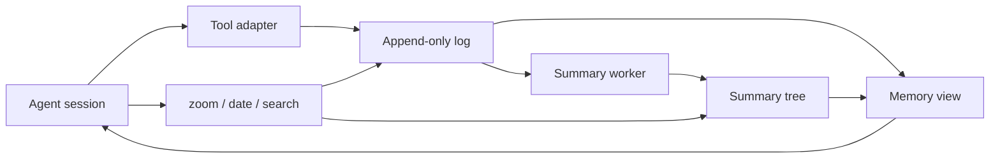

# Architecture

Orrery gives a workspace a memory that survives changes of session, coding tool and model.
A lane names that workspace and its memory store.
The coding tool still owns the current interaction: its editor, terminal, tools and agent model.
Orrery records selected conversation events, builds summaries, and supplies a bounded view of the past.

This separation is useful when a project outlives one model's context window.
Starting a new session should not require retelling every decision.
Switching from pi to Claude Code should not create a second, unrelated project history.
Changing the agent model should not change where its memory lives.
The store is local and inspectable; summaries are derived data rather than the only surviving record.

## A lane from prompt to recall

A lane has a configured workspace, a directory under `data_dir/lanes/`, and a summary model.
The `tool` setting selects pi, OMP, Claude Code or Codex for launching.
The optional `launcher` setting selects direct launch or Ori.
Those launch choices do not select a different memory database.
Codex currently launches without an Orrery memory adapter.

At a session boundary, the adapter finds the lane from the working directory.
It opens the writer if available, loads the saved view, and starts summary work.
Before an agent run it adds memory according to the host's supported prompt mechanism.
Selected new messages enter the log with stable source identities or cursors where the host provides them.
A later session reads the same log and view, regardless of the previous agent's model.

The host adapter decides what constitutes a recordable event.
pi and OMP record user messages and completed assistant text, without copying every tool exchange.
Claude Code's plugin records prompts and final replies through hooks.
The older durable runtime and imported histories can contain additional message kinds.
Hidden reasoning is not a memory source.

## The store

Each lane's `memory.sqlite` contains four logical areas:

| Table | Contents |
|---|---|
| `main` | Ordered messages: kind, original text, byte size and date |
| `tree` | Summaries addressed by tree level and position |
| `meta` | Saved view, adapter progress and other small persistent state |
| `usage` | Agent or summary usage reported to Orrery |

The message log is append-only during normal operation.
Summaries do not overwrite the original message.
Messages and progress markers can be committed together, so a restart can distinguish new work from replay.
This matters when an adapter receives the same session history after resume or rewind.
It also makes a failed import transaction easier to reason about.

The database uses WAL mode and full synchronization for writes.
Text is stored as UTF-8 blobs because tool and imported text may contain embedded NUL characters.
Using blobs avoids truncation in the Node SQLite text interface.
Byte sizes are UTF-8 byte counts, not JavaScript string lengths and not model token counts.
Unicode and binary-shaped text are covered by the storage tests.

Node uses its built-in SQLite implementation.
An alternate backend uses Bun's SQLite interface behind the same small database abstraction.
The Bun store check exercises that backend independently.
A database snapshot and a JSONL export provide recovery paths outside the live process.
Neither the database nor the export is encrypted by Orrery.

## One writer, many readers

One process owns a lane's writer at a time.
Opening the writer also holds an exclusive SQLite lock on a separate `.lock` database.
The operating system releases this lock when the process dies.
There is no stale lock directory to remove and no decision based only on a reused process ID.
The lock database filename can remain on disk after a clean exit.

Status pages, memory tools, exports and other authorized lanes use read-only snapshots.
Readers do not take the writer lock or advance the writer's progress.
A second pi or OMP session cannot quietly become a second recorder.
It reports the conflict and runs without lane memory, while applicable guard rules remain active.
Claude Code can provide a read-only window while its recording window owns the lane.

The rule applies across tools, not just across two copies of the same executable.
Close the recording session before opening the lane in another tool.
Restoring or importing memory also requires the writer to be closed.
This keeps ordering and exactly-once recording tractable without a distributed coordination service.
It intentionally does not support concurrent collaborative writers.

## The summary tree

Every message can have a short leaf summary.
Two adjacent siblings can have a parent summary covering both ranges.
Repeated pairing creates a binary tree over the ordered log.
A parent is built only after its children are available.
Older ranges can therefore be represented at progressively coarser detail.

The default target for a summary node is 512 bytes.
The model receives a length ruler and can be asked to shorten an oversized answer.
The summarizer retains the shortest candidate after its bounded shortening attempts.
A summary is useful context, not a proof that every fact survived compression.
The original message remains available when a summary is incomplete or misleading.

Summary work runs in the background with configurable parallelism.
Ready merges take priority over ready leaves, so a long import does not postpone the whole upper tree.
Leaves are admitted near the frontier of built context.
Queues track work made ready by each append or completed node.
Scheduling does not repeatedly scan the entire history to find candidates.

Provider failures leave the source messages intact.
Failures are retried and surfaced through status and notices.
An unavailable or stopped summary source is visible in the TUI and tool footer.
If the adapter's wait budget expires, a run may see unsummarized placeholders it can inspect through memory tools.
The product does not silently present a stopped compactor as healthy.

## The view is a cut through the tree

The agent does not receive every message or every summary.
A `MemoryView` selects non-overlapping parts that cover the history in order.
Recent material has finer detail; older material can use larger summary ranges.
Each rendered line carries an address such as `id+n|text` inside a `<chat>` block.
The address links the compressed representation back to its source range.

`zoom(id, n)` expands a range into its two children.
With `n = 1`, it returns the original message in full.
Larger spans must be aligned powers of two with available children.
`date(id)` returns a message's timestamp.
`search` finds words or a regular expression in the original log, newest first.
OMP calls this last tool `memory_search` to avoid its own search-tool naming conflict.

A lane may grant reads of named other lanes, or `reads = ["*"]`.
Such a reader also gets `lanes` and `lane_memory`.
These tools use snapshots; they never append to the other lane.
Their access checks use the configured lane relationships.
The memory browser exposes the current view, source messages and summary tree to the user.

## Keeping the prompt prefix stable

Prompt caching depends on repeated prefixes, so reshuffling old lines every turn is expensive.
Orrery lets the view grow between occasional batches of merges.
At the default settings, its built content grows from about 64 KB toward a 128 KB ceiling.
These are decimal byte budgets, not guaranteed token-window sizes.
A host prompt, tools and current conversation add their own tokens on top.

Appending a message adds a new line at the end; it does not immediately merge old lines.
When built content crosses the ceiling, a batch merges eligible sibling pairs toward the half-size floor.
Only a pair whose parent summary exists can be merged.
If summaries lag, the batch progresses as the required parents become available.
Unbuilt placeholders count as zero built bytes.

The merge priority measures a pair's age from its last message, scaled by its level.
Ties prefer older pairs.
This avoids repeatedly rewriting an old prefix merely because its first message is very old.
Between merge batches, the existing view lines remain unchanged and new lines extend their suffix.
Tests compare those prefixes byte for byte over long synthetic histories.

The selected parts are saved as `view.parts` metadata.
Reopening a lane loads that selection rather than recomputing a different cut through the same tree.
Readers use the same saved selection.
A missing or invalid saved view is rebuilt once; a read-only reader rebuilds only in memory.
New messages appended outside the view join as additional lines on the next open.

Persistence is designed to recover from an interrupted merge batch.
A crash can leave an older valid view, and the next writer continues from it.
The view is a performance and context selection, while the log is the underlying record.
This distinction allows recovery without replacing the original messages.
It also avoids rebuilding already completed summaries merely because the selection changes.

## Summaries need a smaller context

A summary call receives its own view, normally between 16 KB and 32 KB.
Its ceiling is configurable through `compactor_context_bytes`, with a floor at half that value.
At open it is derived from the chat view and merged further.
After that it grows and batches independently in memory.
It is not repeatedly rebuilt whenever the agent view merges.

The context ends at the node being summarized and includes only built lines.
A leaf's context stops before that message; a merge can see through the range it covers.
No placeholder or partial message is presented as a completed summary.
A fixed summary system prompt precedes the context and task.
Lane names and changing timestamps do not churn that fixed prefix.

For providers supporting explicit cache marks, context is grouped into blocks of four lines.
The Anthropic request path marks a stable whole block as well as the request end.
When several jobs share a new prefix, one starts before the others so it can establish the cache entry.
Other providers use their own prefix-caching rules.
A stable prefix makes reuse possible; it does not guarantee a particular provider's cache-hit rate.

The agent and compactor may use different models and different credentials.
Their caches should therefore be treated separately.
The smaller summary view limits input even when a provider does not reuse its cache.
Usage records expose input, output and reported cache tokens so the effect can be measured.
The TUI distinguishes subscription-backed usage from priced API usage where that information is available.

## Adapters and boundaries

The memory core in `src/memory/` does not depend on an agent UI.
Shared lane code handles configuration, model sources, tools, notices and settings requests.
Each host adapter translates its own event and tool shapes into those shared operations.
The TUI and CLI use the same lane settings and launch plans.
A launcher does not become an additional memory writer.

**pi:** the extension adds the view to the system prompt and trims already-recorded history at run boundaries.
It preserves the current interaction while long-term history is represented by the lane view.
Session identities and recording progress prevent ordinary resumes from copying the same messages twice.
The extension uses pi-supplied pi-ai entry points when loaded by the compiled executable.
Tests enforce this import boundary because a second, incompatible provider runtime can fail only at call time.

**OMP:** a separate entry point uses the compatible extension layer with host-specific tool and event handling.
Orrery temporarily disables overlapping OMP memory and compaction behavior for the lane session.
Those settings are restored when the session leaves the lane.
This relies on some OMP internals and is version-sensitive; failure produces a visible status notice.
See [OMP](omp.md) for guard coverage, overflow behavior and tested versions.

**Claude Code plugin:** short-lived hooks spool prompts and final replies to a lane holder process.
The holder owns the writer, drains events and runs summaries.
An MCP server exposes memory tools through read-only access.
Trusted per-workspace setup controls which folders receive the view file and recording behavior.
Shared repositories use local files and local Git exclusions rather than changing shared project instructions.

**Claude Code mod:** the optional mod supplies a dedicated system-prompt section for memory.
The section stays stable between session boundaries and compactions.
The mod can replace compaction while the existing hooks continue recording and guarding.
It depends on the host's mod interface and is more tightly coupled than the plugin alone.
See [Claude Code](claude-code.md) for setup, compaction behavior and current limitations.

**Ori:** Ori supplies OpenRouter models to the agent executable.
Orrery launches `ori pi`, `ori omp`, `ori claude` or `ori codex` in the lane workspace.
The optional `ori_model` is passed through as `--model`.
Ori's pi provider suppression affects the session registry; Orrery's separate summary registry survives it.
[Ori](ori.md) records the tested startup incompatibility with OMP and the manual Claude check still required.

**Durable runtime:** `orrery run` remains an alternative built on pi-durable.
It owns a durable session database alongside the memory store and can execute tools over SSH.
Its projector commits recording progress with memory appends.
This path also underlies the optional always-on deployment helpers.
It is retained alongside the extensions, with a broader dependency surface and separate tests.

## Summary sources and credentials

Summary sources are grouped as Sign in, API key and Local.
OpenAI sign-in and OpenRouter PKCE sign-in are offered independently of the coding tool's account.
API keys are entered through a hidden terminal field or the Logins page.
Custom compatible model servers come from explicit provider configuration.
A candidate model is tested before a settings change replaces the working summary source.

OpenRouter sign-in uses a verifier, S256 challenge and callback state.
A temporary loopback server receives the redirect; a manual redirect URL or code works when necessary.
Cancellation, timeout and failed exchanges close the callback server.
The resulting API key uses the same OpenRouter slot as a pasted key, with origin metadata for display.
Replacing either origin with the other emits a notice rather than creating two ambiguous logins.

Credentials live in Orrery's own private file, normally `credentials.json` under `data_dir`.
New credential files use mode 0600; UI enumeration exposes metadata rather than secret values.
Orrery does not read Ori's credential store or borrow its private helper for summaries.
A launcher session's environment remains the user's environment.
Ori's telemetry, updates and cloud-session settings are explained separately in its guide.

## The credential guard

The guard rejects known credential paths and disallowed file-tool targets.
Shared rules handle normalization and symlinks; adapters map each host's arguments to those rules.
Host-specific checks cover multi-file edits and known credential locations.
Some ambiguous OMP edit or glob forms are refused because their targets cannot be judged reliably.
The rules are tested against concrete tool shapes and need review when upstream parsers change.

This is a credential guard, not a sandbox.
Shell and evaluation tools receive text checks, not an operating-system isolation boundary.
Generated code can reach files through mechanisms the guard cannot see.
Unknown plugin tools and hook failures can also fall outside the protection offered by a host integration.
Do not use it as the security boundary for untrusted code or a hostile agent.

Memory and exports can contain sensitive conversation content even when credentials are protected.
Import scrubbing catches known secret shapes but still requires user review of the preview.
Backups retain history and must be protected like the original database.
Keep keys, local backup settings and real conversations outside the repository.
A deployment's OS permissions and account boundaries remain part of its security design.

## Tests and trade-offs

Unit tests cover tree addresses, byte accounting, summary scheduling, view persistence and failure behavior.
Long synthetic runs check merge order and the stable-prefix property.
Python parity tests regenerate expected trees and views through the retained OptChat reference implementation.
They compare both fresh builds and continuing runs, with Unicode and varying message lengths.
The Python oracle is a behavioral reference, not the runtime serving a lane.

Adapter tests exercise resumes, rewinds, tool calls, recording conflicts and cross-tool ownership.
Real pi and OMP tests load the actual installed binaries with scratch homes and fake model services.
The real-Ori test uses a fake catalog and synthetic credentials without a live model call.
A missing binary skips its real-tool tests; a known Ori/OMP mismatch is a named compatibility skip.
Paid live checks and the opt-in Claude script are separate from the default test suite.

The core trade-off is compression with recoverable detail: summaries can lose facts, but `zoom` reaches the source.
A local single-writer store favors predictable ordering and simple recovery over simultaneous collaboration.
Stable view batches favor cache reuse over continuously optimizing every line of context.
Independent summary credentials make model choice explicit at the cost of a separate login.
Host adapters preserve familiar tools, while exposing Orrery to upstream event and parser changes.

The design does not promise perfect recall, provider cache hits or identical behavior in every agent version.
It makes the history, selected view, summary failures and integration limits inspectable.
For commands and setup, start with the [README](../README.md) and the linked tool guides.
